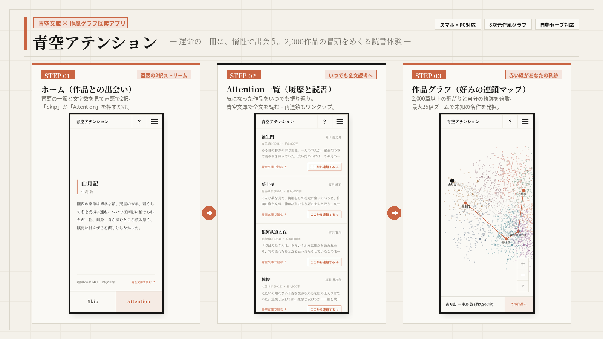

# 青空アテンション (Aozora Attention)

青空文庫に収蔵された近代日本文学の名作群を、多次元スタイル空間（耽美・怪奇・古典・心理・無頼・情熱・随筆・詩情）の8次元ベクトルとネットワークグラフで繋ぎ、TikTok / Reelsのような感覚で1篇ずつ出会えるミニマルWebアプリケーションです。

画面下部の **Skip** / **Attention** を直感的に選び続けるだけで、あなたの潜在的な読書嗜好が動的に学習され、次なる名作へとレコメンドが連鎖していきます。

---

## 主な機能と特徴

- **初回自動ガイド＆ヘルプ機能**: 初めてアクセスした方にはアプリの使い方をまとめたヘルプ画面が自動で開きます。また、画面右上のメニューボタン左隣にある「？」ボタンからいつでも説明を確認できます。
- **フルブリード・ミニマルUI（ホーム・Attention一覧・作品グラフ）**: Claude調の温かみのあるアースカラー（`#FAF9F5`）と明朝体。画面の余計な装飾を削ぎ落とし、文学の冒頭の一節そのものに没入できます。
- **文字数表示**: 読了時間ではなく、各作品のボリューム感をダイレクトに把握できる「約○,○○○字」表示（夏目漱石『こころ』約152,000字、梶井基次郎『檸檬』約4,900字など）。
- **即時起動（Zero Latency）**: 2,000作品を超える膨大なカタログを保持しつつ、初回表示時は重い座標計算を遅延実行（Lazy Evaluation）することで、ページを開いた瞬間に読書を開始できます。
- **ディープズーム・ネットワークグラフ**:
  - 最大 **25.0倍** までの拡大に対応。
  - スマホの **ピンチイン／ピンチアウト**（2本指操作）およびPCの **マウスホイール**（カーソル位置中心ズーム）に完全対応。
  - 拡大するにつれて、ノードから作品名・著者名が次々と浮かび上がります。
- **安心のセーブ機能（LocalStorage & PageHide）**:
  - 読書中の作品ID、直前にAttentionした作品、学習された嗜好ベクトル、閲覧履歴をブラウザ内に自動永続化。
  - ページを閉じたりタブを切り替えたりしても、次回アクセス時にまったく同じ状態から再開されます。
- **完全スタンドアロン構成**: 外部CSS/JSライブラリへの依存が一切なく、1枚のHTMLファイルのみで高速動作します。

---

## クレジット・著作権・ライセンスについて

### 青空文庫および収録作品の権利について
- 本アプリに収録されている文学作品のテキスト、タイトル、著者情報は、すべて [青空文庫（Aozora Bunko）](https://www.aozora.gr.jp/) にて著作権保護期間を満了したパブリックドメイン（公有）作品、または訳者・著作者により公開許諾された作品に基づいています。
- 各作品の詳細ページへの外部リンクは、青空文庫の公式図書カードに直接リンクしています。
- 青空文庫の収録作品は商用・非商用を問わず自由に複製・頒布・翻案が認められています。本アプリケーションにおける引用および冒頭抜粋は青空文庫の利用規約に完全に準拠しています。

### ソフトウェアライセンス
- アプリケーション本体のソースコード（HTML/CSS/JavaScript）は **MIT License** のもとで提供されます。個人利用・商用利用・改変・再配布が自由に行えます。
